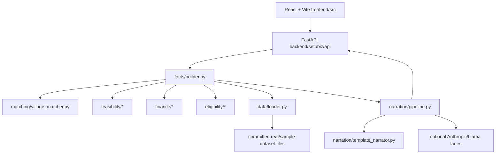

# SetuBiz: AI-Driven Hyper-Local Business Advisory and Financial Structuring Assistant

## Project Overview
SetuBiz is a deterministic advisory application for rural micro-entrepreneurs. It combines
village-level data, feasibility estimates, deterministic finance/eligibility logic, and a
narration/report layer to produce a Rural Enterprise Planning Report.

This repository's topic is **SIH26091** (see README's existing project naming and
`docs/STUDY_GUIDE.md`). The decision layer is deterministic Python code; AI/LLM components,
when enabled, only explain a locked facts object and never decide numbers or eligibility.

No production database is used. Geography and datasets are stored as committed files and read
through `backend/setubiz/data/loader.py`.

## Problem Being Addressed
Rural micro-entrepreneurs often lack:
- hyper-local market information,
- clarity about affordable loan size,
- eligibility routing by social category,
- and a document checklist suitable for a bank visit.

The official problem statement asks for:
1. a hyper-local feasibility report across six parameters, and
2. a smart financial calculator and scheme router.

SetuBiz implements the finance router exactly for its margin/loan rules, then adds cash-flow
right-sizing (DSCR >= 1.5) and stress tests to avoid over-borrowing.

## Main Features Actually Implemented
- Phonetic village matching (Latin, Devanagari, Kannada script), returning top candidates for confirmation.
- Entire all-India rural village dataset: 588,691 villages across 33 regions.
- Feasibility estimates: market reach, competitor density, demand, threats, SWOT, product-market value.
- NABARD-style cost templates for 8 business categories.
- Scheme routing (NSFDC Logic A/B) and quarterly amortization (both moratorium treatments).
- DSCR right-sizing with -15% and -30% revenue stress tests.
- Eligibility routing and document checklist by social category.
- SHG/group lending support.
- Facts object with per-figure provenance.
- React PWA report, loan comparison, charts, tables, provenance panel, print stylesheet.
- Narrative layer: Jinja template default; optional Anthropic cloud LLM; optional local Llama 3.1 8B.
- Numeric-grounding validator for generated prose.
- Client-side OCR helper (`tesseract.js`) proposing document fields; extraction is advisory only.
- Typer CLI (`setubiz`).
- Docker Compose and Vercel serverless entrypoint.

## System Architecture


No relational database, no pgvector/RAG store, and no trained ML model are currently used.

## Request Flow
1. The frontend `Ask` page collects village, radius, category, savings, social category, income, flags, and language.
2. It calls `GET /api/v1/villages/search` and then `POST /api/v1/advisory`.
3. Backend `routes.advisory()` calls `build_facts()` (`facts/builder.py`).
4. `build_facts()` resolves the village, computes feasibility, routes the scheme, right-sizes and amortizes loans, assesses eligibility, and locks facts plus provenance.
5. `narrate()` runs the narrator ladder and validates every figure with the numeric validator.
6. The frontend renders `facts`, `report`, and `validation`.

## Technology Stack
### Backend
- Python 3.11+
- FastAPI, Uvicorn
- Pydantic 2 (request/response/frozen domain models)
- PyYAML, Jinja2, rapidfuzz, Typer, Rich
- pytest, pytest-cov, ruff, mypy (dev)
- Optional: Anthropic SDK (`.[llm]`), llama-cpp-python (`.[local]`)

### Frontend
- React 18, React Router 7
- Vite 6, TypeScript 5
- Tailwind CSS + UX4G web components
- @fontsource Noto Sans Devanagari/Kannada
- tesseract.js (browser OCR)

### Dataset/ETL Sources
- Census 2011 village tables
- SHRUG v2.2 (village names, shrid IDs, centroids)
- Mission Antyodaya amenities
- Economic Census 2013 density
- HCES 2023-24 demand profiles
- OpenStreetMap POIs (Jharkhand only)
- AGMARKNET daily prices/arrivals
- Official scheme parameters and NABARD-style cost templates

## Repository Structure
```text
setubiz-karnataka-work/
  api/                      Vercel Python entrypoint
  backend/
    setubiz/
      api/                  FastAPI app and routes
      data/                 DataSource protocol, sample + real datasets
      documents/            document extraction/checks
      eligibility/          scheme routing and document rules
      facts/                locked facts + provenance
      feasibility/          six feasibility parameters
      finance/              router, amortization, right-sizing, alternatives, templates
      matching/             village name matcher
      narration/            template/cloud/local narrators and validator
  backend/tests/            392 tests
  etl/                      ETL/build scripts (ignored raw inputs in datasets/)
  frontend/                 React PWA, components, scripts, public assets
  docs/                     PRD coverage, study guide
  Makefile, pyproject.toml, requirements.txt
```

## Important Files
- `backend/setubiz/api/main.py`: FastAPI app and middleware.
- `backend/setubiz/api/routes.py`: API endpoints and request/response models.
- `backend/setubiz/schemas.py`: shared request models (`AdvisoryRequest`, `VillageMatch`, etc.).
- `backend/setubiz/facts/builder.py`: pipeline orchestrator and facts contract.
- `backend/setubiz/finance/router.py`: Logic A/B scheme routing and max loan.
- `backend/setubiz/finance/amortization.py`: quarterly repayment schedules.
- `backend/setubiz/finance/rightsizing.py`: recommended loan and stress test.
- `backend/setubiz/finance/alternatives.py`: smaller units, larger contribution, phased plan.
- `backend/setubiz/finance/cost_templates.py`: template loading/scaling.
- `backend/setubiz/eligibility/rules.py`: eligibility verdict and documents.
- `backend/setubiz/feasibility/*.py`: market, demand, competitors, threats, SWOT.
- `backend/setubiz/matching/village_matcher.py`: phonetic village search.
- `backend/setubiz/narration/pipeline.py`: narrator ladder.
- `backend/setubiz/narration/validator.py`: numeric grounding.
- `backend/setubiz/data/loader.py`: DataSource protocol and file access.
- `frontend/src/pages/Ask.tsx`, `frontend/src/pages/Report.tsx`.
- `frontend/src/api.ts`, `frontend/src/types.ts`, `frontend/src/format.ts`.
- `frontend/src/components/LoanComparison.tsx`, `DscrChart.tsx`, `ScheduleTable.tsx`.

## Datasets and Database Status
No database is used. The app reads files behind a `DataSource` protocol.

Real dataset root:
```text
backend/setubiz/data/real/
  manifest.json
  villages/*.json.gz              (33 regions, 588,691 villages)
  pois/JH.json.gz                (Jharkhand only; 120 POIs)
  ec13_density/*.json + merged ec13_density.json
  hces_demand.json
  arrivals.json
  cost_templates/*.yaml
  schemes/*.yaml
  swot_rules.yaml
```

Open a dataset manually:
```powershell
python -c "import gzip,json; d=json.load(gzip.open('backend/setubiz/data/real/villages/KA.json.gz','rt',encoding='utf-8')); print(d['_meta']); print(d['villages'][0])"
```

Coverage/limitations:
- 33 regions/village shards; Chandigarh and Delhi have no rural village rows in the source.
- 4 small UTs have village shards but no EC13/HCES layers; a full advisory returns a clear 404 rather than invented estimates.
- Only Jharkhand has OSM POIs.
- EC13 and HCES layers cover 29 states.
- Census 2011 vintage; growth scaling is used for forward estimates.
- HCES category shares are all-India rural shares applied to state MPCE.
- Agmarknet data has only current day's values; no seasonality history.

Sample/synthetic data is in `backend/setubiz/data/sample/` and is used by tests via `SETUBIZ_DATA_DIR`. It declares itself synthetic and must not be quoted as findings.

## API Endpoints
Base URL local: `http://localhost:8000`; docs: `http://localhost:8000/docs`; health: `GET /healthz`.
- `POST /api/v1/advisory`: full report (`facts`, `report`, `validation`).
- `POST /api/v1/finance/structure`: finance-only recompute.
- `GET /api/v1/villages/search?q=&state=&limit=`: ranked village matches.
- `GET /api/v1/cost-templates`: templates and derived totals.
- `GET /api/v1/schemes`: corporations and comparison schemes.
- `GET /api/v1/metrics`: data source, estimator, validator catch rate, narrator lane.
- `POST /api/v1/documents/read`: classify/proposals from OCR text.
- `POST /api/v1/documents/check`: deterministic checks on confirmed fields.

## Financial Calculations (High Level)
- PS margin share: `0.10`.
- Project cost maximum: `margin / 0.10`.
- Maximum loan: `min(0.90 * project_cost, scheme cap)`.
- Logic A: project cost <= Rs 1.40L; 6.5%/yr, 3 years, 3-month moratorium, cap Rs 1.25L.
- Logic B: above Rs 1.40L to Rs 50L; 8%/yr, 7 years, 6/12-month moratorium, cap Rs 45L.
- Quarterly rate = annual rate / 4; amortization uses the quarterly-rest formula.
- DSCR = annual net operating income / annual debt service; threshold 1.5.
- Out of scope occurs when project cost exceeds Rs 50L (margin above Rs 5L); max loan becomes 0 and referral schemes are returned.
- Stress factors: 0.85 and 0.70; recommended loan must survive the -15% floor by default.
- Demo numbers: savings Rs 11,00,000 -> max loan Rs 19,00,000; recommended Rs 12,05,000; unit cost Rs 14,10,800; worst-year DSCR at max loan 0.52.

Golden vectors verified by tests: Rs 1,12,501.34 (Logic A capped max loan) and 26 instalments of Rs 1,44,729.31 (Logic B).

## AI and NLP Status
- No trained ML model is currently active.
- Competitor estimator slot exists and raises `NotImplementedError`; deterministic EC13 z-score estimator is used.
- Local demand uses HCES mean-band estimate, not Fay-Herriot small-area estimation.
- Narration default is deterministic Jinja templates.
- Cloud and local LLM lanes are optional/off by default.
- Browser Web Speech API provides ASR-like input; no server-side ASR/TTS.
- `/api/v1/metrics` reports the data source, narrator lane, and validator catch rate.

## Windows Setup
Run npm commands only inside `frontend/`.

```powershell
cd "C:\Users\Keerthan R\KEERTHAN\Projects\setubiz-karnataka-work"
python -m venv .venv
.venv\Scripts\python.exe -m pip install --upgrade pip
.venv\Scripts\python.exe -m pip install -e ".[dev]"
cd frontend
npm install
```

Optional integrations:
```powershell
.venv\Scripts\python.exe -m pip install -e ".[llm]"      # Anthropic cloud narration
.venv\Scripts\python.exe -m pip install -e ".[local]"     # local Llama narration
```

## Environment Variables
Copy `.env.example` to `.env` if needed. Defaults allow offline demo. Never commit `.env`.
- `SETUBIZ_DATA_DIR`: dataset root (default real data)
- `SETUBIZ_DEFAULT_RADIUS_KM`, `SETUBIZ_COMPETITOR_ESTIMATOR`, `SETUBIZ_DEMAND_ESTIMATOR`
- `SETUBIZ_DSCR_THRESHOLD`, `SETUBIZ_STRESS_DSCR_FLOOR`, `SETUBIZ_ENFORCE_STRESS_FLOOR`, `SETUBIZ_RECOMMENDED_LOAN_STEP`
- `SETUBIZ_LLM_ENABLED`, `SETUBIZ_ANTHROPIC_API_KEY`, `SETUBIZ_LLM_MODEL`, etc.
- `SETUBIZ_LOCAL_LLM_ENABLED`, `SETUBIZ_LOCAL_LLM_MODEL_PATH`, etc.
- `SETUBIZ_DATA_GOV_API_KEY` for ETL only
- Frontend uses `SETUBIZ_API` before `npm run dev` if the API is not on port 8000

## Run Backend and Frontend Separately
Terminal 1 (backend):
```powershell
cd "C:\Users\Keerthan R\KEERTHAN\Projects\setubiz-karnataka-work"
.venv\Scripts\python.exe -m uvicorn setubiz.api:app --reload --port 8000 --app-dir backend
```
Open `http://localhost:8000/docs`.

Terminal 2 (frontend):
```powershell
cd "C:\Users\Keerthan R\KEERTHAN\Projects\setubiz-karnataka-work\frontend"
$env:SETUBIZ_API="http://localhost:8000"
npm run dev
```
Open `http://localhost:5173`.

Docker demo: `docker compose up --build` (if Docker is available).

## Tests
```powershell
cd "C:\Users\Keerthan R\KEERTHAN\Projects\setubiz-karnataka-work"
.venv\Scripts\python.exe -m pytest backend\tests --cov=setubiz.finance --cov=setubiz.eligibility --cov=setubiz.documents --cov-fail-under=100
```
Frontend:
```powershell
cd "C:\Users\Keerthan R\KEERTHAN\Projects\setubiz-karnataka-work\frontend"
npm run typecheck
npm run build
```
Latest verified results in this workspace: 392 backend tests passed, TypeScript typecheck passed, frontend build passed. ETL scripts and native LLM integrations were not executed.

## Troubleshooting
- Port 8000 in use: run backend on `--port 8010`, then `$env:SETUBIZ_API="http://localhost:8010"` before `npm run dev`.
- `ModuleNotFoundError`: run `pip install -e ".[dev]"` from repo root.
- npm cannot find package.json: ensure current directory is `frontend`.
- API 404 for full advisory on small UTs: expected because EC/HCES layers are absent.
- `npm run build` creates ignored `frontend/dist`; do not commit it.
- If OCR text has no matching document fields, extraction remains proposed and must be confirmed manually.

## Known Limitations and Future Improvements
- No trained ML model yet; estimation is deterministic v0.
- Browser ASR only; no server-side ASR/TTS.
- Server-side PDF generation is not implemented; use browser print.
- OSM POIs only for Jharkhand.
- No PostGIS, pgvector, RAG, or ministry dashboard.
- Agmarknet history not available; live seasonality chart may not render.
- Kannada report text is machine-translated and needs native review.
- Only some routes enforce UX4G build-time verification; CSS is large in current build.
- Group lending is supported but has no separate assisted VLE mode.

## Security and Privacy Notes
- Do not commit `.env`, raw datasets, `node_modules`, `.venv`, `frontend/dist`, caches, or logs.
- OCR runs in the browser; document upload endpoints accept text only.
- Backend CORS only allows localhost dev origins by default.
- No user authentication/database is implemented.

## Contributors
No contributor names are listed here because names were not found in repository files. Add them only with verified details.
